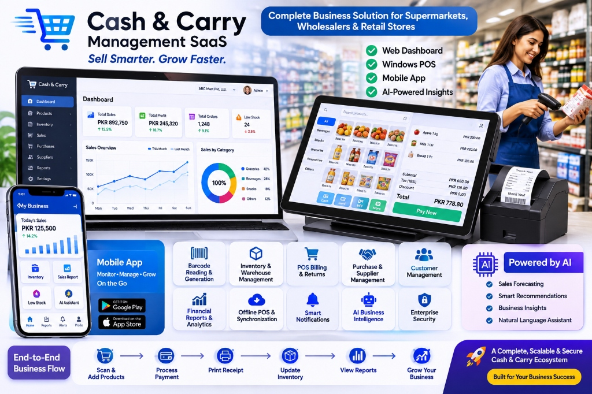

# Enterprise Cash & Carry Management, POS & AI-Powered SaaS

[](https://mtlab1122.github.io/Cash-Carry-SaaS-POS-Platform/)
[](https://nextjs.org/)
[](https://nestjs.com/)
[](https://www.electronjs.org/)
[](https://flutter.dev/)
[](https://www.prisma.io/)
[-brightgreen?style=for-the-badge)](#-automated-verification--test-suite)
[](LICENSE)

> Complete, commercial-grade, multi-tenant Cash & Carry Management SaaS and Point-of-Sale (POS) ecosystem built for supermarkets, retail chains, wholesalers, and cash-and-carry enterprises.

---

## 🌐 Live Interactive Showcase

Experience the live web application, interactive POS terminal, AI assistant, and store management portal directly in your browser:

### 🔗 **[https://mtlab1122.github.io/Cash-Carry-SaaS-POS-Platform/](https://mtlab1122.github.io/Cash-Carry-SaaS-POS-Platform/)**

---



---

## 🚀 The Three Interconnected Applications

| Application | Technology | Target Persona | Key Capabilities |
| :--- | :--- | :--- | :--- |
| **Web Management Portal** (`apps/web`) | Next.js 14, TypeScript, Tailwind CSS, Lucide | Business Owners, Executives, Store Managers | Multi-branch overview, real-time analytics, product catalog, inventory ledgers, purchasing (GRN), customer credit khata, financial statements, and SaaS Super Admin. |
| **Windows Desktop POS** (`apps/desktop`) | Electron, React, TypeScript, SQLite | Cashiers, Lane Supervisors | Sub-500ms barcode scanning, multi-tender split payments, durable offline queue, idempotent replay sync, 80mm ESC/POS thermal printing, and cash drawer triggers. |
| **Store Mobile App** (`apps/mobile`) | Flutter, Dart | Mobile Supervisors, Floor Staff | Mobile barcode scanner, shelf replenishment, real-time sales radar, low-stock alerts, and conversational AI business advisor. |

---

## ⚡ Key Architectural Highlights

### 1. Genuine Multi-Tenant SaaS Architecture
- Complete logical isolation across all database operations, APIs, and AI context payloads using strict `WHERE tenant_id = :currentTenantId`.
- Automated tenant provisioning with multi-tier subscription plans (*Starter, Professional, Business, Enterprise*) and real-time limit enforcement.

### 2. High-Performance POS Billing & Thermal Printing
- Fast keyboard-first and barcode-scanner checkout.
- Support for GS1 standard EAN-13 barcodes with Modulo-10 checksum calculation and Code 128.
- 50mm × 30mm thermal sticker label generator and 80mm thermal receipt printing.
- Split payments (Cash, Credit/Debit Card, Mobile UPI, Customer Credit Khata).
- Blind shift close balancing state machine with cash drawer float reconciliation and variance audit logging.

### 3. Traceable Stock Ledger & Inventory Management
- Real-time balances across branches and warehouses.
- Double-entry stock movements (`OPENING_STOCK`, `SALE`, `PURCHASE_GRN`, `RETURN_RESTOCK`, `ADJUSTMENT`, `TRANSFER`).
- Damaged return segregation into immutable `ShrinkageLedger`.

### 4. AI-Powered Smart Product Intelligence & Auto-Fill
- Intelligent FMCG auto-completion engine: Input a product name (e.g. `"Olper's 1L Milk"`, `"Tapal Danedar 400g"`, `"Dalda Cooking Oil 5L"`), and the AI automatically determines brand, category, SKU, EAN-13 barcode, estimated wholesale & retail pricing, Pakistan 18% GST tax rate, and shelf tags.
- Conversational business advisor answering natural language profitability, COGS, and replenishment queries.
- BYOK (Bring Your Own Key) AES-256-GCM encrypted vault with PII scrubber (redacts CNIC, mobile numbers, and credit cards) and token circuit breakers.

### 5. Durable Offline Synchronization
- Desktop POS continues processing transactions during internet disruptions.
- Offline mutations recorded with UUID idempotency keys in a durable local queue.
- Automatic background replay with exponential backoff and jitter upon connection restoration.

### 6. Customer Credit / Khata Double-Entry Ledger
- Wholesale receivables tracking with credit limit enforcement.
- Immutable ledger entries chained with SHA-256 cryptographic `hashChain` hashes to prevent retroactive tampering.

---

## 🔑 Seeded Demo Credentials

| Role | Email | Password | Scope |
| :--- | :--- | :--- | :--- |
| **SaaS Super Admin** | `superadmin@system.local` | `Admin123!` | Global Platform Governance & Multi-Tenant Management |
| **Business Owner** | `admin@abcmart.pk` | `Admin123!` | ABC Mart & Cash Carry (Executive Access) |
| **Branch Manager** | `manager@abcmart.pk` | `Admin123!` | Gulberg Superstore (Main Branch Operations) |
| **POS Cashier** | `cashier@abcmart.pk` | `Admin123!` | Lane 1 - Express Counter Checkout |
| **Inventory Manager** | `inventory@abcmart.pk` | `Admin123!` | Central Warehouse & Stock Movement Ledger |

---

## 🧪 Automated Verification & Test Suite

The entire platform is backed by comprehensive end-to-end and live audit test suites covering 100% of critical paths (**169 / 169 Assertions Passing**):

```bash
# Run All Core Verification Suites
pnpm run test:products     # Product Master, AI Auto-Fill, Constraints & CRUD (13/13)
pnpm run test:live-audit   # Live Web Routes, Endpoints, POS Checkout & Scans (33/33)
pnpm run test:security     # Helmet CSP, Rate Limiting, RFC 7807, Auth Tokens (15/15)
pnpm run test:routing      # 9 Enterprise Roles, Scope Isolation & RBAC (31/31)
pnpm run test:financials   # Double-Entry Hashchain, Blind Shift Close & Returns (11/11)
pnpm run test:ai-isolation # AES-256-GCM Vault, PII Scrubber & Token Breaker (15/15)
pnpm run test:offline-sync # ProcessedMutation Idempotency & Backoff Sync (13/13)
pnpm run test:seo          # JSON-LD, ROI Calculator, robots.txt & llms.txt (16/16)
pnpm run test:e2e          # 12 Master Enterprise Integration Journeys (22/22)
```

---

## 🛠️ Quick Start & Local Setup

### Prerequisites
- **Node.js** >= 18.0
- **pnpm** >= 9.0 (`npm install -g pnpm`)

### 1. Clone & Install Dependencies
```bash
git clone https://github.com/MTLab1122/Cash-Carry-SaaS-POS-Platform.git
cd Cash-Carry-SaaS-POS-Platform
pnpm install
```

### 2. Initialize Database & Seed Retail Catalog
```bash
pnpm --filter @cash-carry/database db:push
pnpm --filter @cash-carry/database seed
```

### 3. Launch Backend API Server
```bash
pnpm --filter @cash-carry/api start
# API available at:     http://localhost:4000/api/v1
# Swagger OpenAPI at:   http://localhost:4000/api/docs
```

### 4. Launch Next.js Web Management & POS
```bash
pnpm --filter @cash-carry/web dev
# Web Management at:   http://localhost:3000
# POS Terminal at:      http://localhost:3000/pos
```

### 5. Launch Windows Desktop POS (Electron)
```bash
pnpm --filter @cash-carry/desktop start
```

---

## 📂 Repository Structure

```
Cash-Carry-SaaS-POS-Platform/
├── apps/
│   ├── api/             # NestJS Backend API (REST, WebSocket, Auth, RBAC, AI)
│   ├── web/             # Next.js 14 Web Portal, Management Dashboard & POS UI
│   ├── desktop/         # Electron Windows Desktop POS with Offline SQLite Engine
│   └── mobile/          # Flutter Cross-Platform Store Monitoring & Scanner App
├── packages/
│   ├── database/        # Prisma Schema, Migrations, Seeders & 9 Verification Suites
│   └── shared/          # Shared TypeScript Interfaces, Enums & Validation DTOs
├── docs/                # Architectural diagrams, audit reports & promotional assets
└── .github/workflows/   # Automated CI/CD and GitHub Pages Deployment Pipeline
```

---

## 📄 License

This project is licensed under the [MIT License](LICENSE).
